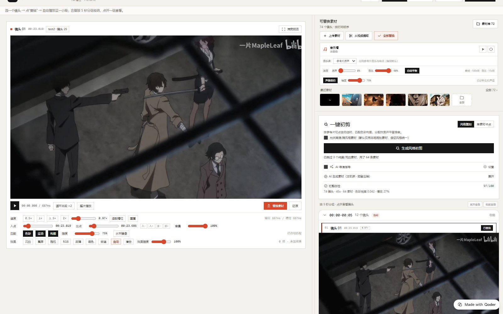
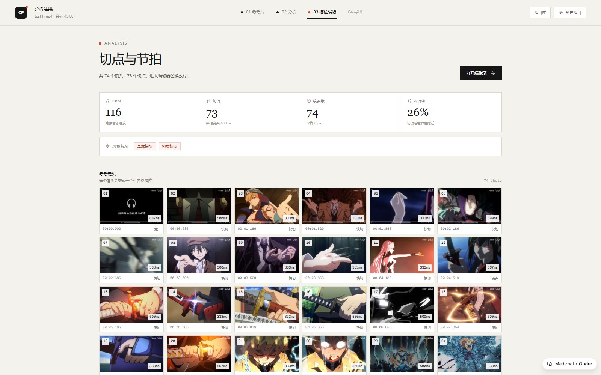
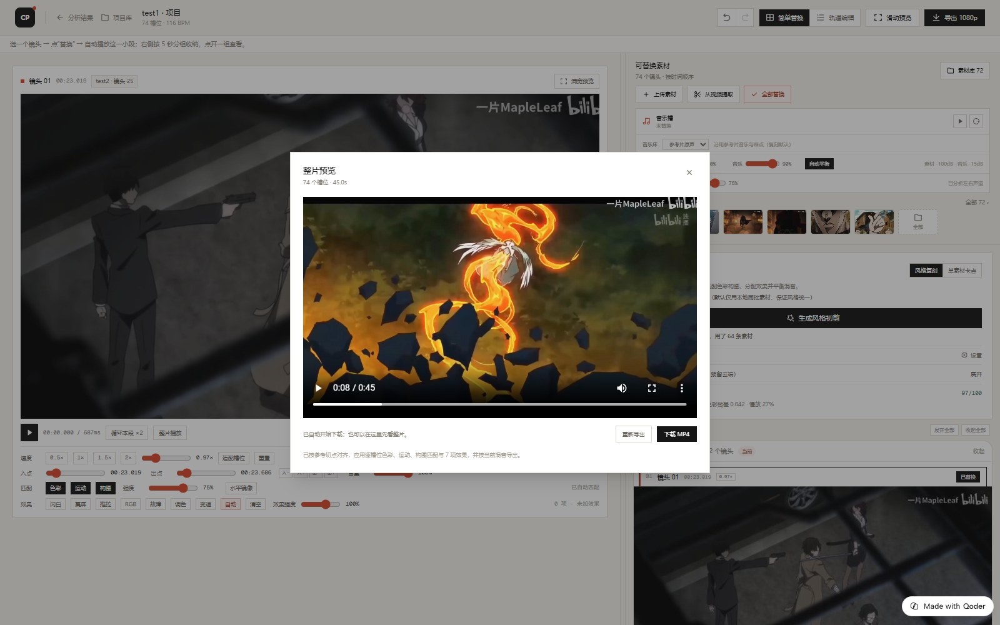

> **English**: [README.md](README.md) | **中文**: [README.zh.md](README.zh.md)

---

# CPvidego · One-Click Anime Hype-Edit Style Replication

**Upload one reference edit. CPvidego analyzes its shot cuts, BPM and beat-hit structure entirely in your browser, then lays your own footage onto the same rhythm.**
No server uploads, no editing skills, no subscription — analysis, planning, color matching, audio mixing and export all run locally.

[](https://github.com/Noob-stupid/cpvidego/stargazers)
[%20%2B%20OpenVideo-informational?style=flat-square)](#license)
[](https://github.com/Noob-stupid/cpvidego/commits/main)
[](https://github.com/Noob-stupid/cpvidego/actions/workflows/ci.yml)
[](https://cpvidego-hm6epec5wn2.qoder.zone)
[](https://github.com/topics/video-editor)
[](https://github.com/topics/ai-editing)

**🎬 Live demo (no install needed) → [cpvidego-hm6epec5wn2.qoder.zone](https://cpvidego-hm6epec5wn2.qoder.zone)**



## Why CPvidego

Cutting a beat-synced hype edit is expensive: frame-by-frame cut hunting, BPM counting, drum alignment, per-clip speed control, per-shot color grading.
Existing tools either keep all of that in the editor's head (timeline apps are just executors) or lock it in a black box (cloud "one-click video" services are unexplainable, uneditable and subscription-gated).

CPvidego takes a third path: **turn rhythm structure into explainable, editable intermediate data**.

- Analysis is deterministic CV / signal processing (cut detection, beat grid, beat-hit rate) — every number is visible on the analysis board;
- Planning is an editable "slot" model; the optional AI director (any OpenAI-compatible LLM) only advises on top of the deterministic engine, it never hijacks the timeline;
- All media stays in the browser (IndexedDB / OPFS) — projects survive page reloads.

## Highlights

| | Capability | Detail |
|---|---|---|
| ✂️ | **One-click draft, two modes** | *Replicate* fits your footage into the reference cut structure; *Beat-sync* re-plans it on the BPM grid. Output is an editable draft, not a black box |
| 🎞️ | **Shot-cut / BPM analysis** | Front-end frame-difference cut detection + `web-audio-beat-detector` beat grid + beat-hit score; adaptive frame sampling for long videos |
| 🎵 | **Music track editing** | Per audio segment: repeat / slow-down / speed-up (0.4–2.0×) / volume (0–200%) / fade in-out / loop — one shared volume-envelope for preview and export |
| 🔊 | **Reference audio bed** | The reference video's own audio is used as one continuous music bed by default (no chopped-dialogue collage); source clips are muted by default |
| 🎨 | **Per-slot color match + effects** | RGB / luma statistics matching against each reference shot; flash, zoom, shake and 4 more beat-aligned effects |
| 🧠 | **Optional AI director** | Any OpenAI-compatible API (DeepSeek / GPT / local models); VLM tagging; keys stay in your browser |
| 🔒 | **Fully client-side** | Videos never leave the machine; 1080p MP4 rendered in-browser via WebCodecs + Remotion |
| 🗂️ | **Local project library** | Projects, assets and audio tracks persisted in IndexedDB / OPFS |

<details>
<summary><b>📑 Table of Contents</b></summary>

- [Why CPvidego](#why-cpvidego)
- [Highlights](#highlights)
- [Workflow](#workflow)
- [Quickstart](#quickstart)
- [Architecture](#architecture)
- [Tests](#tests)
- [Roadmap](#roadmap)
- [Contributing](#contributing)
- [License](#license)
- [Acknowledgements](#acknowledgements)
</details>

## Workflow

1. **Upload a reference edit** — analysis range adapts to its length automatically;
2. **Analyze** — get cuts, BPM, beat grid, shot-length distribution and beat-hit score (100% local);
3. **Import footage** — batch upload clips/images; long clips get highlight scanning, short clips get auto slow-fit;
4. **One-click draft** — pick *Replicate* or *Beat-sync*, get an editable timeline with a 0–100 quality score;
5. **Fine-tune** — replace any slot, swipe-preview alternatives, edit the music track (repeat / speed / volume / fades);
6. **Export** — 1080p MP4 rendered in the browser, bit-identical A/V behavior to the preview.




## Quickstart

Requires Node.js ≥ 20 and pnpm (or npm).

```bash
git clone https://github.com/Noob-stupid/cpvidego.git
cd cpvidego
pnpm install
cp .env.sample .env   # leave everything empty — CPvidego runs with zero backend
pnpm dev              # http://localhost:3000
```

| Command | Purpose |
| :--- | :--- |
| `pnpm dev` | Dev server |
| `pnpm test` | Unit tests (91, full coverage of the pure-function engine) |
| `pnpm typecheck` | TypeScript check |
| `pnpm build` | Standard Next.js build |
| `pnpm build:sites` | Static export (deploy to any static host; the AI proxy ships as a separate Edge Function) |

The `R2_* / DEEPGRAM_API_KEY / PEXELS_API_KEY` variables only serve upstream OpenVideo editor features (cloud storage / transcription / stock media). The CPvidego pipeline never needs them; the AI director key is entered in the app's *AI Settings* and stored locally.

## Architecture

```
src/lib/cpv/            ← deterministic engine (pure TS, unit-tested, UI-free)
  analyze.ts            cut detection / BPM / shot structure (adaptive sampling)
  beat-grid.ts          beat grid & beat-hit rate
  plan-beat.ts          beat-sync planning
  draft.ts              one-click draft orchestration
  audio-track.ts        music-track model (repeat/speed/volume/fades, shared by preview & export)
  audio-mix.ts          reference audio bed & mixing
  color-match.ts        per-slot RGB color matching
  render.ts / render-remotion.tsx   in-browser MP4 export
  ai/                   AI director layer (OpenAI-compatible APIs + VLM tagging, optional)
src/components/cpv/     ← workflow UI (upload / analysis / editor / music panel / library)
src/stores/             ← zustand state + IndexedDB/OPFS persistence
Base: OpenVideo editor (@openvideo/core + engine-pixi, WebCodecs hardware-accelerated)
```

Design rule: **the deterministic engine is the single source of truth for the final cut; AI only advises.** Every engine module is a pure function with tests — you can contribute algorithms without touching the UI.

## Tests

```bash
pnpm test
```

15 test files cover the beat grid, planners, speed fitting, audio track, color matching and AI response parsing. Engine changes must ship with tests.

## Roadmap

- [ ] **Pluggable media sources** — one protocol for local files / URLs / generation backends (ComfyUI) / stock APIs, so the AI can pick footage across sources
- [ ] **True semantic shot understanding** — from rhythm-driven to content-driven placement (semantic tags → constrained slot solving)
- [ ] **Pro-software bridges** — local MCP bridge exporting timelines to Premiere / After Effects / DaVinci Resolve / Blender (3D work belongs to pro tools, not a custom engine)
- [ ] **4K / HDR export**
- [ ] **More beat-style templates** (transition combos, speed curves, kinetic text)

Full plan: [docs/ROADMAP.md](docs/ROADMAP.md). Claim an item by replying on its roadmap issue.

## Contributing

One person can cut one video; a community can define the tools of the AI-editing era.

- Code: read [CONTRIBUTING.md](CONTRIBUTING.md) (dev setup, test bar, PR rules), start from [`good first issue`](https://github.com/Noob-stupid/cpvidego/issues?q=is%3Aissue%20is%3Aopen%20label%3A%22good%20first%20issue%22);
- Ideas / bugs: open an [Issue](https://github.com/Noob-stupid/cpvidego/issues/new/choose);
- Direction discussions: join [Discussions](https://github.com/Noob-stupid/cpvidego/discussions);
- Be kind — see the [Code of Conduct](CODE_OF_CONDUCT.md); report vulnerabilities privately per [SECURITY.md](SECURITY.md).

## License

Dual-layer licensing:

- **CPvidego original layer** (`src/lib/cpv/**`, `src/components/cpv/**`, CPV stores, tests, scripts): [MIT](LICENSE-CPVIDEGO) — use it, modify it, build with it;
- **Editor base** (the remaining upstream code): [OpenVideo License](LICENSE) — free (including commercially) for individuals and teams of ≤3; larger organizations need an upstream commercial license.

CPvidego is therefore a **source-available community project**: our layer is plain MIT open source; distribution of the whole app must respect the OpenVideo terms. Upstream feedback is welcome at [openvideodev/openvideo](https://github.com/openvideodev/openvideo).

## Acknowledgements

- [OpenVideo](https://github.com/openvideodev/openvideo) — the browser video-editing engine this builds on
- [Remotion](https://remotion.dev) — in-browser rendering
- [web-audio-beat-detector](https://github.com/chrisguttandin/web-audio-beat-detector) — beat detection
- [Qoder](https://qoder.com) — AI development tooling and Sites hosting for this project
