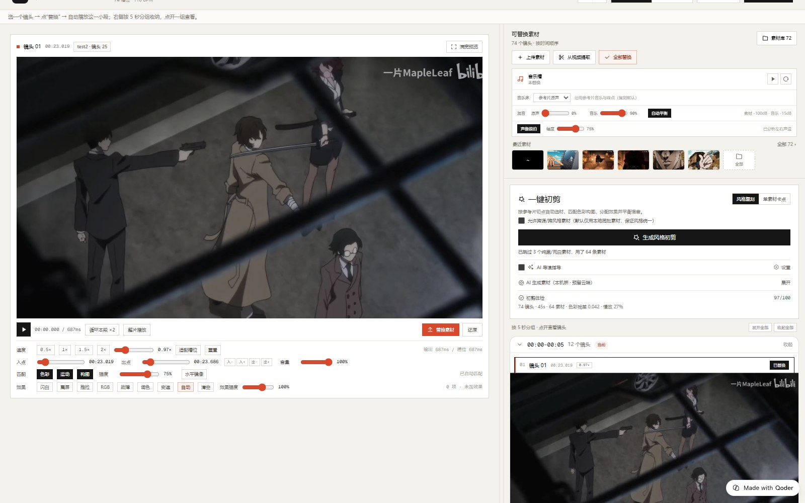
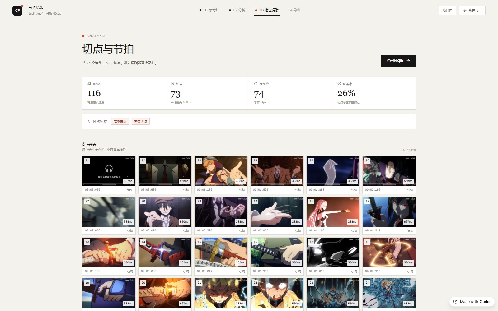
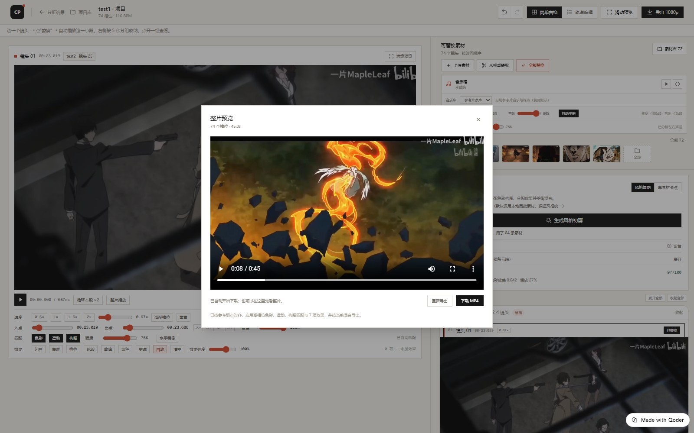

> **English**: [README.md](README.md) | **中文**: [README.zh.md](README.zh.md)

---

# CPvidego · 动漫高燃风格一键复刻

**上传一支参考视频，CPvidego 在纯浏览器里分析它的镜头切点、BPM 节拍与踩点结构，把你自己的素材一键排成同一节奏的成片。**
不上传服务器、不需要剪辑基础、不需要订阅——分析、排片、调色、混音、导出全部在本地完成。

[](https://github.com/Noob-stupid/cpvidego/stargazers)
[%20%2B%20OpenVideo-informational?style=flat-square)](#许可证)
[](https://github.com/Noob-stupid/cpvidego/commits/main)
[](https://github.com/Noob-stupid/cpvidego/actions/workflows/ci.yml)
[](https://cpvidego-hm6epec5wn2.qoder.zone)
[](https://github.com/topics/video-editor)
[](https://github.com/topics/ai-editing)

**🎬 在线体验（无需安装，直接可用）→ [cpvidego-hm6epec5wn2.qoder.zone](https://cpvidego-hm6epec5wn2.qoder.zone)**



## 为什么做 CPvidego

剪一支"踩点燃向"的成本极高：你要逐帧找参考片的切点、数 BPM、对齐鼓点、控制每段素材的速度、再逐镜头调色。
现有工具要么把这件事留在人脑里（传统时间线编辑器只是执行器），要么把它锁进黑盒（云端一键成片不可解释、不可编辑、要订阅）。

CPvidego 走第三条路：**把"节奏结构"变成可解释、可编辑的中间数据**。

- 分析是确定性的 CV/信号处理（切点检测、节拍网格、踩点率），每一步都能在看板里看到依据；
- 排片是可手动干预的"槽位"模型，AI（可选接入任意 OpenAI 兼容大模型）只是在确定性引擎之上给建议，不接管成片；
- 所有素材留在浏览器（IndexedDB / OPFS），关掉页面也不丢项目。

## 核心能力

| | 能力 | 说明 |
|---|---|---|
| ✂️ | **一键初剪（两种模式）** | 「复刻剪辑」把素材塞进参考片的切点结构；「踩点成片」按 BPM 鼓点重排。生成的是可编辑草稿，不是成品黑盒 |
| 🎞️ | **镜头切点 / BPM 分析** | 纯前端帧差切点检测 + `web-audio-beat-detector` 节拍网格 + 踩点率评分；长视频自适应降帧采样 |
| 🎵 | **音乐轨道编辑** | 独立音频轨：分段重复 / 放慢加快（0.4–2.0×）/ 音量（0–200%）/ 淡入淡出 / 循环，预览与导出同一套音量包络 |
| 🔊 | **参考音床** | 默认整条使用参考片自己的音轨作为连续音乐床（避免"台词拼贴感"），素材原声默认静音 |
| 🎨 | **逐槽色彩匹配 + 转场特效** | 每个槽位对参考镜头做 RGB / 亮度统计匹配；卡点闪黑、缩放、摇摆等 7 项效果对齐节拍 |
| 🧠 | **AI 导演（可选）** | 接入任意 OpenAI 兼容 API（DeepSeek / GPT / 本地模型均可），Key 存本地；VLM 给素材打标，AI 只在建议层工作 |
| 🔒 | **完全客户端** | 不上传任何视频；导出用 WebCodecs + Remotion 在浏览器内渲染 1080p MP4 |
| 🗂️ | **本地项目库** | 项目、素材、音频轨持久化在 IndexedDB / OPFS，支持封面、重命名、续作 |

<details>
<summary><b>📑 目录</b></summary>

- [为什么做 CPvidego](#为什么做-cpvidego)
- [核心能力](#核心能力)
- [使用流程](#使用流程)
- [快速开始](#快速开始)
- [架构](#架构)
- [测试](#测试)
- [路线图](#路线图)
- [参与共建](#参与共建)
- [许可证](#许可证)
- [致谢](#致谢)
</details>

## 使用流程

1. **上传参考视频** —— 拖入一支你想复刻节奏的高燃剪辑（分析范围自动适配片长）；
2. **分析** —— 得到切点数、BPM、节拍网格、镜头时长分布与踩点率看板（全程本地）；
3. **导入素材** —— 批量上传你自己的视频 / 图片，长素材自动高光扫描、短素材自动慢放填槽；
4. **一键初剪** —— 选择「复刻剪辑」或「踩点成片」，得到带质量评分（0–100）的可编辑时间线；
5. **微调** —— 替换任意槽位、滑动预览即时换素材、在音乐轨道上重复 / 放缓 / 调音量 / 淡入淡出；
6. **导出** —— 浏览器内渲染 1080p MP4，音画与预览严格一致。

**1 · 分析看板**（切点 / BPM / 镜头时长 / 踩点率）



**2 · 一键初剪与质量评分**


**3 · 导出**



## 快速开始

要求：Node.js ≥ 20，pnpm（或 npm）。

```bash
git clone https://github.com/Noob-stupid/cpvidego.git
cd cpvidego
pnpm install
cp .env.sample .env   # 可全部留空——CPvidego 主流程零后端可运行
pnpm dev              # http://localhost:3000
```

| 命令 | 作用 |
| :--- | :--- |
| `pnpm dev` | 开发服务器 |
| `pnpm test` | 单元测试（91 个，纯函数引擎全覆盖） |
| `pnpm typecheck` | TypeScript 检查 |
| `pnpm build` | 标准 Next.js 构建 |
| `pnpm build:sites` | 静态导出（可部署到任意纯静态托管，AI 代理走独立 Edge Function） |

`.env` 中的 `R2_* / DEEPGRAM_API_KEY / PEXELS_API_KEY` 只服务于上游 OpenVideo 编辑器的云存储 / 转写 /  stock 素材功能，CPvidego 的分析与成片流程完全不依赖它们；AI 导演的 Key 在应用内「AI 设置」填写，仅存浏览器本地。

## 架构

```
src/lib/cpv/            ← 确定性引擎（纯 TS，可单测，无 UI 依赖）
  analyze.ts            切点检测 / BPM / 镜头结构（自适应采样）
  beat-grid.ts          节拍网格与踩点率
  plan-beat.ts          踩点排片规划器
  draft.ts              一键初剪编排
  audio-track.ts        音乐轨道模型（重复/变速/音量/淡变，预览导出同口径）
  audio-mix.ts          参考音床与混音
  color-match.ts        逐槽 RGB 统计色彩匹配
  render.ts / render-remotion.tsx  浏览器内 MP4 导出
  ai/                   AI 导演层（任意 OpenAI 兼容 API + VLM 打标，可选）
src/components/cpv/     ← 工作流 UI（上传/分析/编辑器/音乐轨道面板/项目库）
src/stores/             ← zustand 状态 + IndexedDB/OPFS 持久化
vendor 基座：OpenVideo 编辑器（@openvideo/core + engine-pixi，WebCodecs 硬件加速渲染）
```

设计原则：**确定性引擎是唯一的成片依据，AI 只做建议层**。引擎全部为纯函数并有单测覆盖，方便社区在不碰 UI 的情况下贡献算法。

## 测试

```bash
pnpm test
```

15 个测试文件覆盖节拍网格、排片规划、速度拟合、音频轨道、色彩匹配、AI 建议解析等全部核心纯函数。任何引擎改动请附带测试。

## 路线图

- [ ] **素材源插件接口** —— 统一「本地文件 / URL / 生成模型（ComfyUI）/ 素材库 API」的选源协议，让 AI 可以跨源挑素材
- [ ] **AI 语义理解选中素材** —— 从"按节奏排"进化到"按内容排"（镜头语义标签 → 槽位约束求解）
- [ ] **专业软件桥接** —— 通过本地 MCP 桥导出工程到 Premiere / After Effects / DaVinci Resolve / Blender（3D 场景类需求走外部软件而非自研引擎）
- [ ] **4K / HDR 导出**
- [ ] **更多卡点风格模板**（转场组合、变速曲线、文字节奏）

完整规划见 [docs/ROADMAP.md](docs/ROADMAP.md)，想认领哪个直接在对应 Roadmap issue 下回复。

## 参与共建

一个人能剪一支片，一群人能定义 AI 剪辑时代的工具。

- 想改代码：读 [CONTRIBUTING.md](CONTRIBUTING.md)（本地开发、测试口径、PR 规范），从 [`good first issue`](https://github.com/Noob-stupid/cpvidego/issues?q=is%3Aissue%20is%3Aopen%20label%3A%22good%20first%20issue%22) 开始；
- 有想法 / 发现 bug：提 [Issue](https://github.com/Noob-stupid/cpvidego/issues/new/choose)；
- 想聊方向：加入 [Discussions](https://github.com/Noob-stupid/cpvidego/discussions)；
- 交流请遵守[行为准则](CODE_OF_CONDUCT.md)；安全问题请按 [SECURITY.md](SECURITY.md) 私报。

## 许可证

本仓库采用**双层许可**：

- **CPvidego 原创层**（`src/lib/cpv/**`、`src/components/cpv/**`、CPV stores、测试与脚本）：[MIT](LICENSE-CPVIDEGO) —— 随便用、随便改、欢迎拿去共建；
- **编辑器基座**（其余上游代码）：[OpenVideo License](LICENSE) —— 个人与 ≤3 人团队免费（含商用），更大团队需上游商业授权。

因此本项目是 **source-available 的共创项目**：CPvidego 层是无条件 MIT 开源；整体分发的商业使用请遵守 OpenVideo 条款。欢迎向上游 [openvideodev/openvideo](https://github.com/openvideodev/openvideo) 反馈。

## 致谢

- [OpenVideo](https://github.com/openvideodev/openvideo) —— 浏览器端视频编辑引擎基座
- [Remotion](https://remotion.dev) —— 浏览器内渲染导出
- [web-audio-beat-detector](https://github.com/chrisguttandin/web-audio-beat-detector) —— 节拍检测
- [Qoder](https://qoder.com) —— 本项目的开发工具与 Sites 托管
